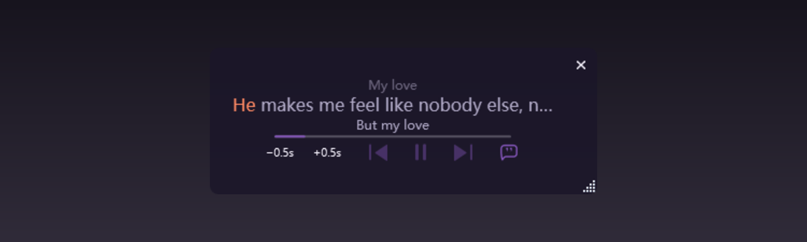
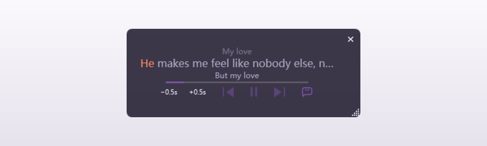
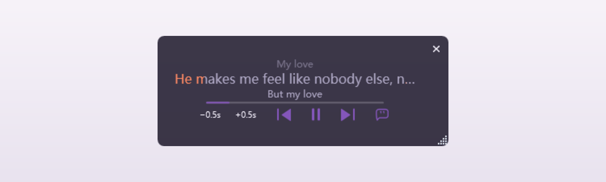
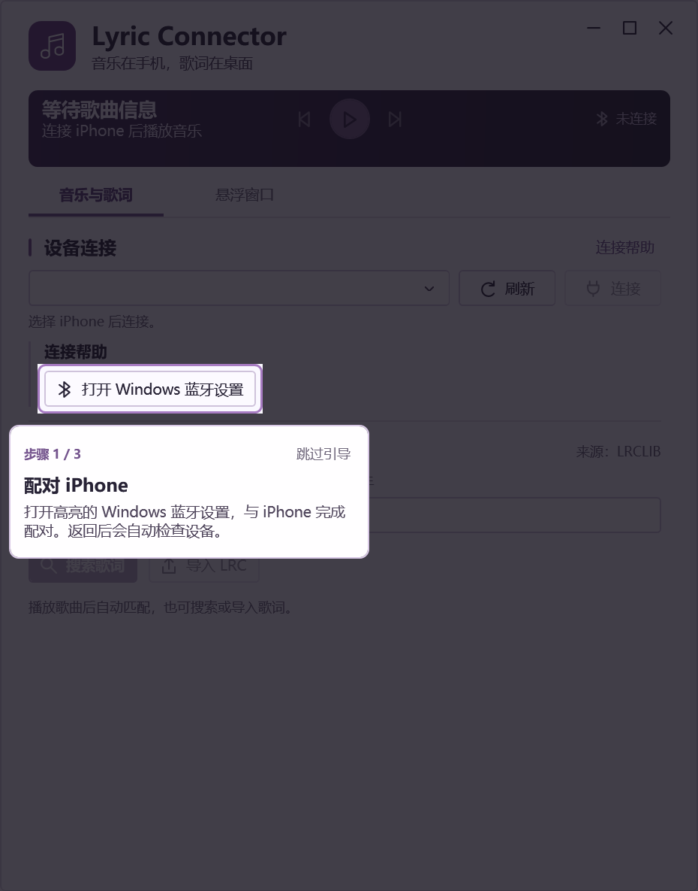
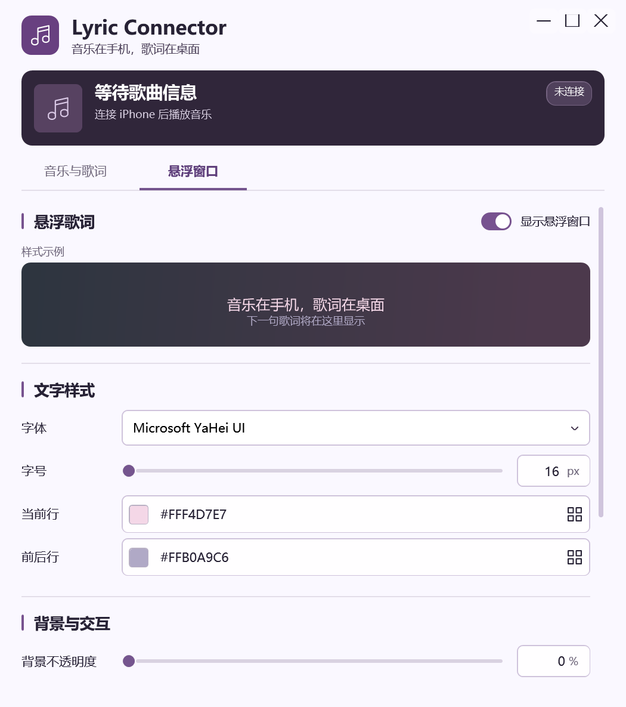
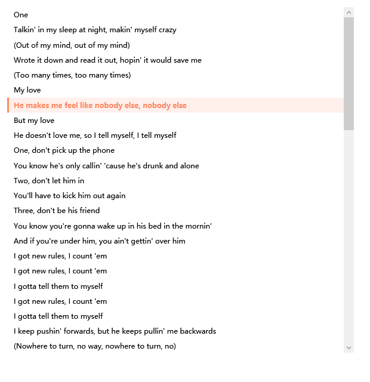

# Lyric Connector

English | [简体中文](README.zh-CN.md)

Keep listening on your iPhone and show synced lyrics on your Windows desktop. Lyric Connector reads the current song and playback position, looks up lyrics, and displays them in a lightweight floating window. You can also control playback from the overlay. Your phone does not need a companion app or an open lyrics page.

## Background

If you listen on your phone or through headphones, you may still want lyrics on your computer screen. Lyric Connector leaves music playback and audio on the iPhone. The desktop app handles lyric matching, timing, appearance, and playback controls. It reads media status over Bluetooth using Apple Media Service (AMS), without reading the phone's screen or capturing audio.

## Quick start

To run from source, you need Windows, 64-bit Windows PowerShell 5.1, Python 3, Bluetooth LE, and an iPhone paired with Windows. The installed WPF executable needs Windows with .NET Framework 4.8 and Bluetooth support; it does not need Python or `probes/`. GitHub Releases provides a standalone EXE, a ZIP of the full runtime directory, a setup installer, and SHA-256 checksums. The app is unsigned, and installation testing on a clean Windows system is still pending.

1. Pair your iPhone in Windows Bluetooth settings, then start playing music in YouTube Music or Apple Music on the phone.
2. From the project root, run `python desktop/run.py` in Windows PowerShell, or `python3 desktop/run.py` in WSL with Windows interoperability enabled.
3. If the app does not connect automatically, click Refresh (刷新) in the desktop control window, select your iPhone, and click Connect (连接). Check the lyric candidates and choose the right recording. If an Apple Music title differs from the Chinese title in the lyrics database, edit the title and search again. You can import a local LRC file when online lyrics are unavailable.

## Screenshots

The dark and light desktop examples use the same screenshot of the lyric overlay, composited onto sample backgrounds so you can compare text and panel contrast.

| Dark desktop background | Light desktop background |
| --- | --- |
|  |  |

These examples use the same light background with the pointer over the overlay. With click-through off, hovering reveals the controls and raises the background opacity to 85%. With click-through on, mouse events pass to the window underneath, so the controls stay hidden and the overlay keeps its configured opacity.

| Click-through off: hover controls visible | Click-through on: no hover response |
| --- | --- |
|  |  |

On first launch, the Spotlight Tour highlights the next real action and follows pairing, device discovery, selection, and connection:

The music and lyrics page keeps the iPhone selector and connection actions visible alongside playback and lyric matching:

The full lyrics window:

## Overlay features

- Shows the previous, current, and next lyric lines. The current line fills progressively using LRC timestamps. Timing is estimated per line, without word-level synchronization.
- Shows a short progress bar when the player reports the total duration. Hover to reveal previous track, play/pause, next track, lyric offset, and full lyrics controls.
- Raises background opacity to 85% on hover and restores your setting when the pointer leaves. The top-right button hides the overlay; you can show it again from the system tray menu.
- Adjust lyric timing in 0.5-second steps from the overlay. The desktop control window also supports 0.25-second adjustments and a reset to zero.
- Opens a separate full lyrics window that follows playback and highlights the current line. Plain text lyrics can be read in full but do not scroll in sync with playback.
- Toggles click-through with `Ctrl + Alt + L`. With click-through off, you can drag the overlay, resize it from the bottom-right corner, or double-click it to open the desktop control window.
- Lets you set the font, font size, current and next line colors, background opacity, and whether the overlay stays on top.
- Enables playback controls according to the AMS commands supported by the iPhone player. Hiding the overlay keeps the app running. Closing the control window leaves the app in the system tray.

## Support and development status

| Platform or feature | Status | Details |
| --- | --- | --- |
| Windows + iPhone + YouTube Music | Implemented and tested | Verified song metadata, playback position, pause/resume, seeking, track changes, and previous/play-pause/next control events. |
| Windows + iPhone + Apple Music | Metadata, lyrics, and basic controls tested | Read track metadata and retrieved 69 lines of synced lyrics. Pause/resume and next track worked from the overlay. When total duration is missing, lyrics and elapsed time remain visible, and the proportional progress bar is hidden. |
| Desktop lyric overlay | Implemented | Supports three lyric lines, progressive fill on the current line, a short progress bar, hover controls, click-through, full lyrics, dragging and resizing, lyric offsets, and appearance settings. |
| iPhone NetEase Cloud Music, QQ Music, Kugou Music, and Spotify | Integrated; testing in progress for each player | Reads media status through AMS. Handles the combined metadata fields reported by NetEase, QQ, and Kugou. Online lyric lookup is enabled only for supported players. |
| macOS / Linux desktop | Not supported | The desktop app depends on Windows WinRT Bluetooth APIs and WPF. WSL can launch the Windows app when Windows interoperability is available. |
| Windows installers and signing | Released; full installation testing pending | GitHub Releases provides an unsigned standalone EXE, portable ZIP, and Inno Setup installer. Testing on a clean Windows system is pending. Microsoft Store MSIX is the preferred signing route; Partner Center identity, final icons, and Store review are still pending. |
| Automatic updates | Not implemented | The app has no automatic update mechanism. |

The Windows desktop MVP is complete. NetEase Cloud Music, QQ Music, Kugou Music, and Spotify are integrated, with further testing planned for each player. Apple Music works through the shared AMS integration for media status, lyrics, and basic controls.

## Limitations

- An iPhone player may play music without exposing AMS status to Windows or accepting remote commands.
- This version requires manual reconnection after Bluetooth disconnects. Testing with the phone locked, headphones in use, and after sleep/resume is still pending.
- Lyrics come from the [public LRCLIB service](https://lrclib.net) or local files. Coverage and how well the lyrics match your recording vary by song. Automatic lookup checks the local cache first, then uses the same candidate search as manual lookup. If an Apple Music title differs from a Chinese entry in the database, edit the title and search again. Check for covers and live versions before choosing. Plain text lyrics have no line-by-line timeline.
- Playback position comes from the player. The timing difference between the displayed lyrics and actual audio has not been measured systematically.

## Documentation

The [full guide](docs/README.md) covers background, installation and usage, how the app works, data handling, limitations, and player support plans. The detailed documentation is currently in Chinese.

See the [installer plan](docs/installation-plan.md) for packaging progress and installation checks, and [runtime dependencies](docs/distribution-runtime-dependencies.md) for the differences between source scripts and the installed app. Microsoft Store MSIX is the preferred distribution route. The project owner needs to reserve the app name in Partner Center and configure a private test audience; the [MSIX guide](docs/msix-store-packaging.md) lists the remaining steps. The [SignPath investigation](docs/signpath-path.md) covers SignPath Foundation eligibility and its process. Other options are covered in the [code signing research](docs/code-signing-options.md).

Implementation details and test records are in the [desktop MVP notes](docs/desktop-mvp.md), [technical plan](docs/technical-plan.md), and [YouTube Music AMS validation](docs/youtubemusic-ams-validation.md).

## License

This project is licensed under the MIT License. See [LICENSE](LICENSE) for details.
