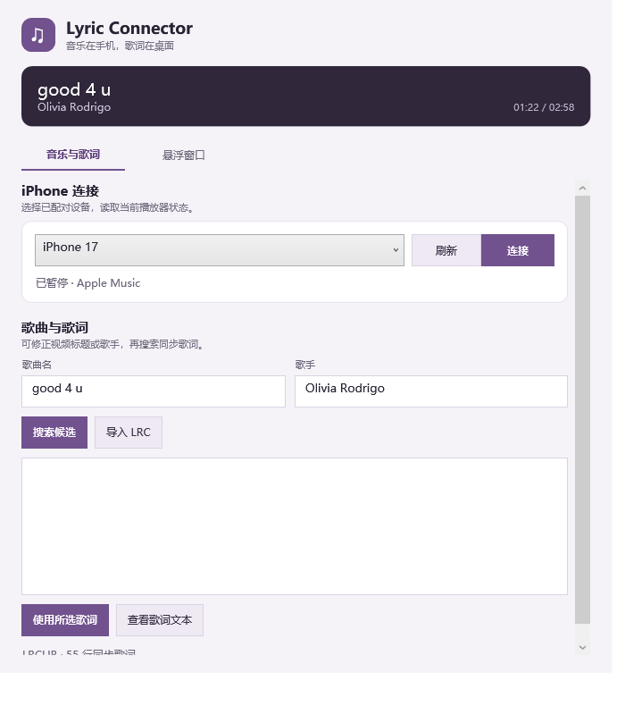
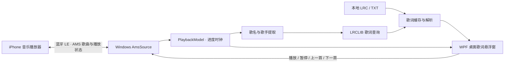

# Lyric Connector

Lyric Connector 将 iPhone 正在播放的音乐同步到 Windows 桌面歌词窗口。手机继续负责音乐播放和音频输出，桌面端负责歌词匹配、时间轴、显示样式，以及基本的播放控制。




## 背景与目标

听歌时可以继续使用 iPhone 和耳机播放，不必切换到桌面播放器，也不依赖手机上的歌词页面。桌面程序通过蓝牙读取 iPhone 提供的媒体状态，再自行查询歌词并渲染当前行和下一行。悬浮窗中的上一首、播放 / 暂停、下一首按钮也会把操作发送给 iPhone。

当前已在 Windows + iPhone + YouTube Music 组合上完成真实连接、歌曲状态读取、进度变化、暂停 / 恢复、切歌和播放控制验证。其他 iPhone 播放器尚未逐一验证；能否取得进度或执行控制取决于播放器实际提供的媒体服务。

## 使用前准备

此处的 Python 和 PowerShell 条件仅针对从源码启动。通过安装器启动时，程序是编译后的 WPF EXE，不会调用 `desktop/run.py` 或 `probes/`；仍需 Windows 的 .NET Framework 4.8 和蓝牙环境。当前本地测试安装器未签名，且尚未完成安装验收。

- Windows 电脑，系统 WPF 和蓝牙 LE 可用。
- iPhone 已在 Windows 蓝牙设置中配对，且 Windows 蓝牙已开启。
- 当前源码启动方式需要 64 位 Windows PowerShell 5.1 和 Python 3；未来的安装程序会提供独立启动方式。
- 桌面可执行程序目标为 .NET Framework 4.8。
- 支持提供 Apple Media Service（AMS）媒体状态的 iPhone 播放器。当前验证过 YouTube Music。

当前可从源码启动；独立 WPF 程序、Inno Setup 内部安装包定义和 Microsoft Store MSIX 打包项目已加入仓库。本机已生成未签名测试安装器 `artifacts/installer/LyricConnector-Setup-0.1.0-x64.exe`，但尚未安装或验收；该目录被 Git 忽略，不会随源码提交。MSIX 的身份和商店视觉资源仍是占位草案，尚未生成 MSIX。

## 启动

在 Windows PowerShell 中进入项目目录后运行：

```powershell
python desktop/run.py
```

如果在启用了 Windows 程序互操作的 WSL 终端中运行：

```sh
python3 desktop/run.py
```

默认会寻找名称为 `iPhone` 的已配对设备。如果手机显示为其他名称，可指定名称：

```sh
python3 desktop/run.py --device-name 'iPhone 17'
```

启动后，先在 iPhone 的 YouTube Music 中播放一首歌。桌面控制窗口会尝试连接设备；如果未自动连接，点击“刷新”，选择 iPhone，再点“连接”。连接成功后，窗口会读取当前歌曲并开始查询歌词。关闭桌面控制窗口会将它隐藏到系统托盘，悬浮歌词和手机状态连接继续运行；点击右下角托盘图标可重新打开控制设置，右键图标后选择“退出 Lyric Connector”才会结束程序。

## 日常使用

控制窗口会显示手机返回的歌曲、歌手、播放状态和进度。歌词匹配使用视频标题与频道名推断出的歌名和歌手；若 YouTube Music 标题包含频道、MV、翻唱等内容，可以修正检索框后点击“搜索候选”。没有精确匹配时，请检查候选的歌手、时长和版本，再选中结果并点击“使用所选歌词”。程序不会默认采用搜索结果中的第一条，以免把翻唱或现场版本误配为原唱。

如果在线歌词缺失，可以点击“导入 LRC”导入当前歌曲的 UTF-8 `.lrc` 或 `.txt` 文件。带时间戳的 LRC 会随播放进度高亮；纯文本歌词可以通过“查看歌词文本”窗口阅读，但没有时间轴时不会模拟逐行同步。

悬浮窗显示当前歌词、下一行和较短的播放进度条。鼠标移入窗口后会显示上一首、播放 / 暂停和下一首图标；鼠标移开后控件会延迟收起。播放控制是否可用取决于 iPhone 播放器支持的 AMS 命令。进度条用于展示播放位置。

双击悬浮面板可激活桌面控制窗口，打开歌词匹配和显示设置。单击歌词仍可拖动悬浮窗；开启鼠标穿透时，需先关闭穿透才能双击操作。

桌面控制窗口关闭后会驻留在系统托盘。单击右下角 Lyric Connector 图标可恢复控制设置；右键图标可选择退出。退出时程序会保存设置并关闭悬浮窗。

桌面控制窗口的“悬浮窗口”设置可调整歌词字体、字号、背景透明度、当前行和下一行颜色、窗口置顶、歌词文字显示 / 隐藏及全局歌词偏移。颜色支持快捷色板，也可输入 `#RRGGBB`。歌词偏移每次以 0.25 秒调整。悬浮窗可拖动和调整大小。

按 `Ctrl + Alt + L` 可切换鼠标穿透。启用穿透时，悬浮窗不接收鼠标操作；要使用悬浮窗播放按钮或移动窗口，请先关闭穿透。背景透明度可以设为 0，窗口仍保留透明的鼠标命中区域；将指针移到歌词窗口或进度条附近会显示控件，方便移动到按钮上操作。

## 工作原理



1. **读取手机状态：** Windows 连接到已配对的 iPhone，并订阅 AMS 的歌曲元数据和播放状态。程序读取标题、歌手、专辑、时长、播放 / 暂停状态和进度；不读取手机屏幕、歌词页面或音频。
2. **稳定曲目快照：** 切歌时先清空旧进度与歌词，等待元数据稳定后再读取完整曲目信息，避免异步歌词结果覆盖新歌曲。蓝牙状态通知用于响应播放和拖动进度，稳定播放期间以单调时钟外推位置，并定期向手机校准。
3. **识别并查询歌词：** 对 YouTube Music 等视频标题清理 MV、字幕、频道和翻唱等附加信息，提取候选歌名与歌手。优先验证精确元数据，未命中时向 LRCLIB 搜索；结果需由用户核对选择。无法可靠推断时保留原始标题供用户修正。
4. **同步显示：** 已选歌词按曲目信息缓存在本机。LRC 时间戳与手机播放位置比较，桌面每 50 毫秒刷新歌词行和短进度条；暂停时冻结位置，手机拖动进度后更新时间锚点。
5. **发送播放命令：** 悬浮窗按钮通过 AMS Remote Command 向 iPhone 请求上一首、播放 / 暂停或下一首。手机播放器可以不支持某些命令，界面会按服务提供的能力启用控件。

## 数据与网络

显示设置和歌词映射保存在 Windows 当前用户的 `%LOCALAPPDATA%\LyricConnector` 目录：`settings.json` 保存窗口设置，`lyrics` 目录保存已选择或导入的歌词。歌词缓存按标题、歌手、专辑和曲目时长生成本地标识；AMS 没有提供跨播放器通用的曲目 ID。

只有查询在线歌词时，程序才会访问 [LRCLIB 公网服务](https://lrclib.net) 并提交歌名 / 歌手检索条件；接口说明见 [LRCLIB API 文档](https://lrclib.net/docs)。服务暂时不可用或未收录歌曲时，可以稍后重试、修正检索信息或导入本地歌词。歌词覆盖率和版本准确性由歌词源及具体歌曲决定。

## 当前范围与限制

- 当前桌面程序依赖 Windows 的 WinRT 蓝牙和 WPF API，不支持原生 macOS 或 Linux 桌面运行。WSL 启动需要 Windows 程序互操作。
- 已验证的播放器组合为 iPhone + YouTube Music；其他播放器、锁屏、耳机并用、电脑休眠和蓝牙断开后的恢复还需要单独测试。
- 蓝牙断开后本版需要在控制窗口手动重新连接。
- AMS 的进度是播放器报告的位置，不等同于实测音频波形。当前尚未完成歌词相对实际听感的误差测量。
- 歌词匹配结果可能对应不同翻唱、现场或发行版本，使用前应核对候选。纯文本歌词无法逐行同步。
- 源码启动方式通过系统 PowerShell 在启动时载入桌面 C# 源码。独立 WPF 项目、Inno Setup 定义和手动 Windows 打包工作流已加入，实际安装工件与干净系统验收仍待完成；尚无自动更新机制。

Windows 安装程序的实施进度和验收步骤见[安装包方案](installation-plan.md)。项目已选择 Microsoft Store MSIX 作为首选免费签名与分发路线；Partner Center 应用身份、真实 Windows 验收和 Store 审核尚未完成。Inno Setup 继续用于内部试用，不会由 Store 签名。对 SignPath Foundation 的资格和流程核查见[SignPath 资格核查](signpath-path.md)，整体对比见[签名方案调研](code-signing-options.md)。

## 支持度与后续适配计划

| 播放器 / 平台 | 状态 | 说明 |
| --- | --- | --- |
| iPhone + YouTube Music + Windows | 已实现并完成基本实测 | 已验证歌曲信息、播放进度、暂停 / 恢复、拖动进度、切歌和 AMS 基本播放控制。 |
| iPhone 网易云音乐 | 计划适配，尚未验证 | 需要实测 AMS 元数据、进度通知及 Remote Command 支持情况。 |
| iPhone QQ 音乐 | 计划适配，尚未验证 | 需要实测 AMS 元数据、进度通知及 Remote Command 支持情况。 |
| iPhone Apple Music | 计划适配，尚未验证 | 需要验证 Windows 直连路径下的媒体状态和控制行为。 |
| iPhone Spotify | 计划适配，尚未验证 | 先验证 AMS；如果信息不足，再单独评估播放器官方接口及其授权要求。 |
| 其他 iPhone 播放器 | 待调研 | 只在设备与具体版本上完成状态和控制验证后，才确认支持。 |

适配按每个播放器分别推进：先确认是否提供可用的歌曲、时长、进度和播放状态，再测试暂停 / 恢复、拖动和切歌通知，最后验证上一首、播放 / 暂停、下一首命令。接入层会将不同来源转换为桌面统一使用的播放状态，歌词查询和悬浮窗继续由桌面端负责。具体备选技术路线见[技术方案](technical-plan.md)。

当前开发阶段是 **Windows 桌面 MVP 已完成，本地 Inno 测试安装器已生成，MSIX 与安装验收仍待完成，播放器兼容性扩展待推进**。连接稳定性、断线重连、锁屏与休眠场景、歌词音频对齐精度，以及安装器的安装和功能验收仍需继续验证。

## 开发检查

在可调用 Windows PowerShell 的环境中运行针对性检查：

```sh
python3 desktop/run.py --test
```

如需检查当前歌词服务的网络查询路径：

```sh
python3 desktop/run.py --check-lyrics
```

第二条命令会访问 [LRCLIB](https://lrclib.net)。实现细节和真实连接验证记录见[桌面 MVP](desktop-mvp.md)、[技术方案](technical-plan.md)和[YouTube Music AMS 实测](youtubemusic-ams-validation.md)。
