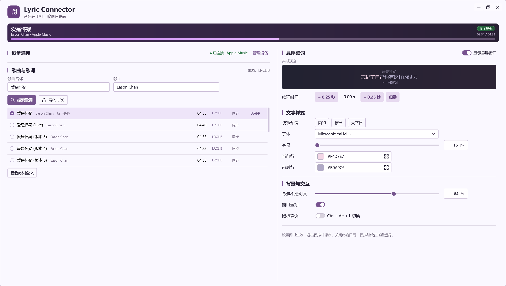
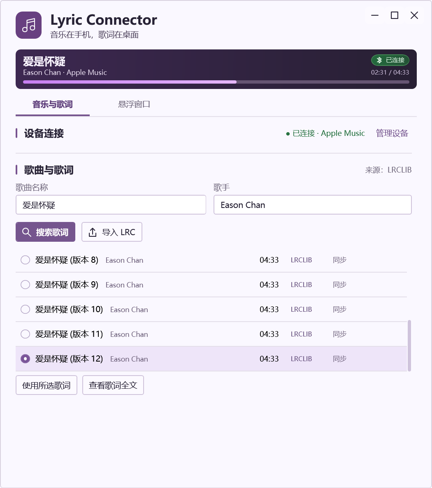
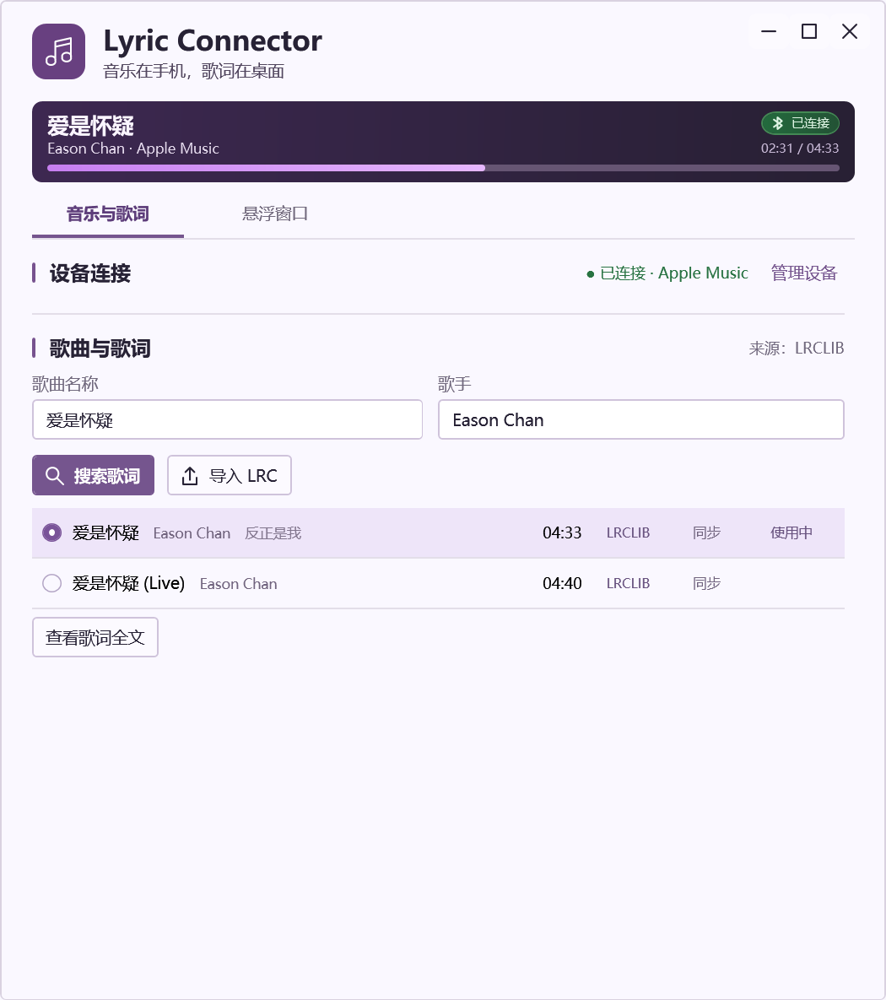
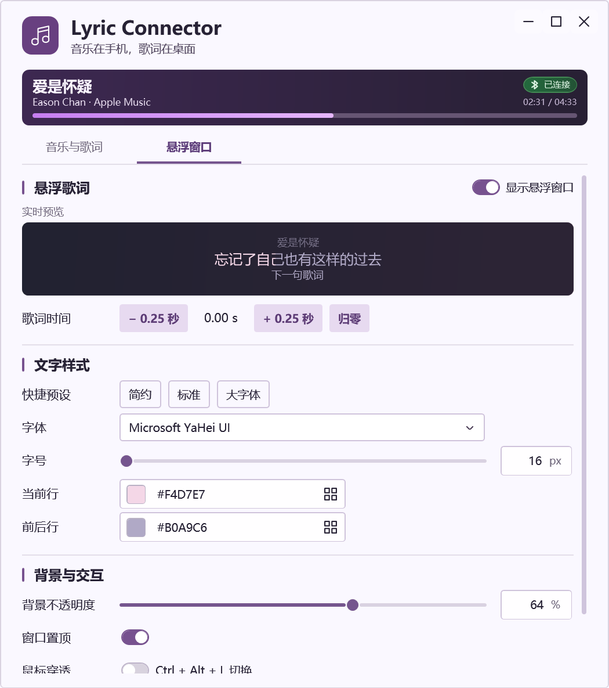
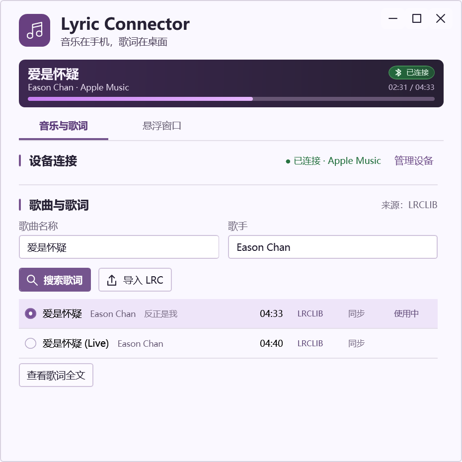
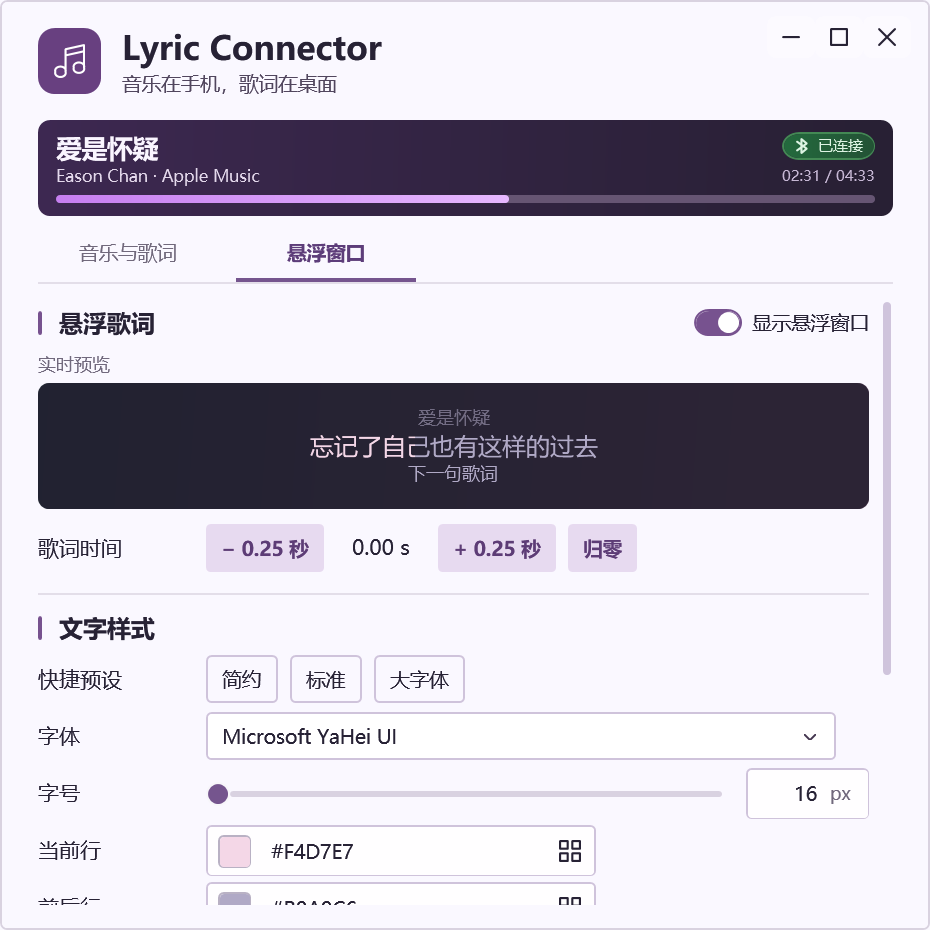
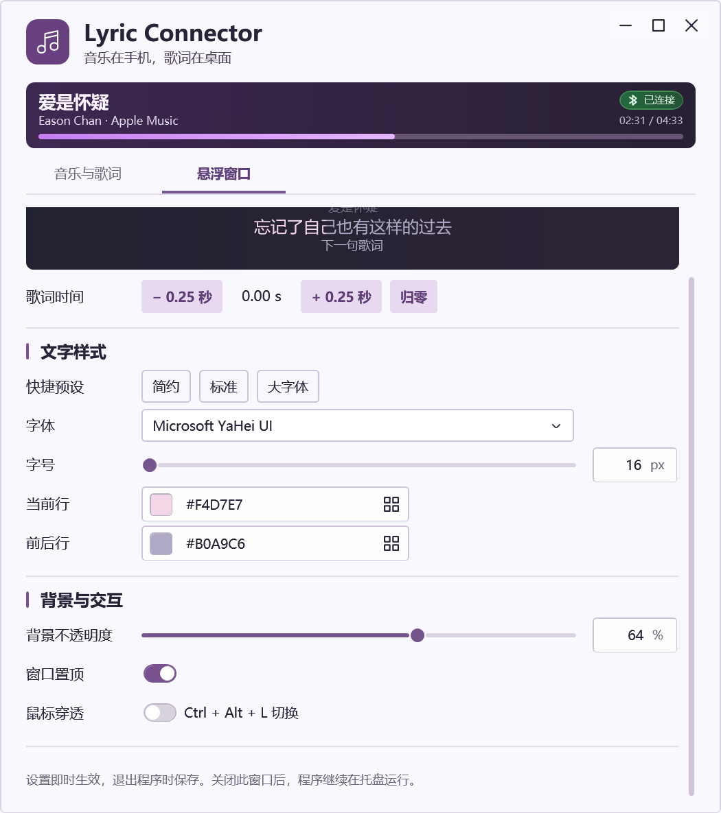

# UI 重构实现与审查

本轮按参考图重做 WPF 控制窗口，默认 700×790、最小 620×620 DIP。普通窗口显示“音乐与歌词 / 悬浮窗口”两个 Tab；根据后续确认的需求，最大化时隐藏 Tab，将音乐与歌词、悬浮设置并排展示，还原后恢复之前选中的 Tab。品牌和播放器固定，主体独立纵向滚动。

访谈确认增加内嵌预览：有同步歌词时与真实悬浮窗共用播放位置、三行歌词和逐行填色；隐藏悬浮窗不停止预览。没有同步歌词时显示标注“样式示例”的两行文字。预览背景是固定的示例桌面，叠加用户实际设置的面板不透明度。

| 发现的问题 | 修改方式 | 实际修改文件 | 验证结果 |
| --- | --- | --- | --- |
| 连接、悬浮显示采用独立大卡片，说明文字占据空间 | 去掉外层卡片，以标题、对齐和分割线组织内容；连接帮助按需展开，连接成功收起 | `desktop/Windows.cs` | 实机截图及首连帮助检查通过 |
| 播放器缺少比例进度和播放器来源 | 紧凑深紫渐变面板显示歌曲、歌手、来源、蓝牙连接状态、时长和圆角进度条；未知时长隐藏比例条，并保留位置以免布局跳动 | `desktop/Windows.cs` | 实机收到曲目快照并载入 34 行同步歌词；截图正常 |
| 空候选区固定高度，候选描述过长 | 空态只留一行提示；候选使用轻量列表行，显示歌手、时长、来源和时间轴状态；相似度、置信度留在悬停提示中 | `desktop/Windows.cs` | 默认 / 最小窗口检查无横向裁切 |
| 当前歌词与所选候选难以区分 | 用“使用中”标记已应用版本，隐藏重复应用按钮，选中其他版本后显示显式选用 | `desktop/Windows.cs` | 当前版本与替代版本交互检查通过 |
| 刷新、搜索缺少重复提交限制 | 操作期间显示进行中状态并禁用重复操作；取消或切歌时释放对应搜索状态 | `desktop/Windows.cs` | 既有播放、切歌和歌词搜索回归检查通过；实机验证过服务不可用反馈 |
| 字号只支持滑块，颜色常驻多排色块和重复“应用” | 统一设置行、紫色滑块、字号精确输入、弹出色板；HEX 按 Enter / 失焦校验，无效输入保留上次有效效果 | `desktop/Windows.cs` | 非法颜色、透明度 HEX、字号范围、色板键盘操作检查通过 |
| 设置页缺少直接可见的外观反馈 | 抽取实际三行歌词渲染组件，两处复用同一计算结果；字体、颜色、字号同步应用 | `desktop/LyricTextView.cs`、`desktop/Windows.cs` | 隐藏悬浮窗后的歌词一致性、填色进度、透明度和字号检查通过 |
| 缺少主动断开入口，自动重连与用户意图冲突 | 主动断开取消连接任务并停止本次运行期间的自动重连；再次连接恢复；意外掉线仍自动重连 | `desktop/Windows.cs` | 主动断开抑制重连、意外掉线继续重连检查通过 |
| 截图只覆盖当前页，未按实际 DPI 导出 | 截图覆盖两个 Tab、设置页下半部分和最小窗口，按窗口实际 DPI 渲染客户区 | `desktop/Windows.cs` | 当前 Windows 150% / 144 DPI 下截图及布局检查通过 |

设置文件格式和原有保存时机保留：通常在退出程序时保存；首次连接与“简约 / 标准 / 大字体”预设操作仍会保存。主窗口关闭后驻留托盘，界面不再声称关闭窗口即保存。快捷操作还会清理字号框中的无效输入。

蓝牙协议、设备发现、播放器识别、歌词匹配排序、解析和缓存逻辑未修改。全文歌词、导入、歌词时间偏移、置顶、穿透及快捷键、悬浮窗拖动与播放控制均保留。生产项目不包含 UI 检查代码，也未新增依赖。检查实现位于 `desktop/Tests.cs` 与 `desktop/UiChecks.cs`，`desktop/run.py` 增加 `--check-ui` 入口，`desktop/LyricConnector.csproj` 明确排除 UI 检查源码。

## 参考图视觉对照

窗口使用带音乐标识的自绘标题栏，保留拖动、缩放、最小化、最大化、还原和关闭到托盘行为。播放面板按新的参考图使用深紫渐变背景，左侧歌名和歌手 / 来源上下排列，右侧为蓝牙连接状态和时长，下方为淡紫渐变圆角进度条。应用标识仅保留在标题栏；移除播放面板中重复的音符占位图与来源行小音符，歌曲信息与进度条沿同一左边缘对齐。连接状态显示在设备标题行，连接成功自动收起设备操作，“管理设备”可重新展开，名称和完整标识仍可核对。

`desktop/ControlTheme.cs` 定义圆角输入框、只读字体选择框、开关、细滚动条和功能图标。颜色与字号控件分别采用一体化色块 / HEX / 色板入口和数值 / 单位表面。分区标题带紫色竖线，按钮使用搜索、导入、刷新及连接图标。候选行在单行中紧邻展示歌名、歌手和已有的专辑信息，时长、来源、同步属性与“使用中”标记固定对齐；选中行显示紫色单选圆点和浅紫背景。

内嵌预览继续复用真实歌词渲染。窗口宽度小于 1100 DIP 时使用双 Tab，达到 1100 DIP 后采用左 55% / 右 45% 双栏；两种布局共用同一套控件和状态，切换布局不触发重连或重建设置。

关闭状态的开关使用淡色轨道与细边界，悬停和键盘聚焦时边界加深；检查验证聚焦关闭状态下圆点完整落在轨道内部，并导出 `verification/switch-off-focused.png`。

字号滑块点击、拖动和聚焦时保持透明底色。标题栏三个图标由 16 DIP 缩小至 12 DIP，保留原点击区域。歌词候选列表固定行高，最多显示 5 行，超过后内部滚动，保留所有候选及版本选择能力。

新增 UI 检查覆盖最大化双栏、还原后 Tab 恢复、布局切换后的连接状态保持、12 个候选的 5 行限高及滚动选用、系统字体下拉选择与整面点击展开、显示开关对应的真实悬浮窗状态。测试截图见下方；已修正数字输入框内边距导致的裁切，并通过默认 / 最小尺寸的横向裁切检查。

## 2026-11-05 宽度与单选标记修正

移除页面整体的 1560 DIP 最大宽度，左右保留固定 24 DIP 留白，播放器铺满内容区。分栏按窗口实际宽度切换，宽窗口采用 55% / 45%，支持非最大化状态拖动调整。设备操作区限制为 640 DIP；右侧预览伸缩，字体、颜色与滑块保留各自宽度限制。

候选单选标记在 Windows 150% 缩放下出现内圆点向右、向下各偏移一个物理像素。实际测量外圈圆心为 (7.333, 7.333) DIP，内点圆心为 (8, 8) DIP；单独显式居中不能消除偏移。关闭圆形标记子树的布局取整后，外圈尺寸为 15 DIP、内点为 5 DIP，圆心均为 (7.5, 7.5)。保留居中声明，并增加同心与切换候选后标记唯一性的回归检查。页面其他部分继续使用布局取整。

补充检查覆盖 1800、1200、700、620 DIP 窗口宽度，确认整体铺满、左右留白、播放器宽度、分栏比例、预览伸缩与设备 / 设置控件宽度限制。

## 2026-11-05 输入与操作控件修正

歌词时间按钮使用淡紫实色背景和较强字重，区别于白底描边输入框。背景不透明度原为 `TextBlock`，已替换为可聚焦的百分比输入框，支持 0–100 整数、Enter / 失焦提交、错误提示及滑块 / 预览双向同步；重复应用同一预设也会清除无效输入。

字体关闭自由编辑并移除下拉模板中的编辑文本框，选项来自系统字体，已保存字体保留在列表。文字区、空白区和箭头命中同一个展开按钮；绑定 `SelectionChanged`，选择后立即同步设置和歌词渲染。歌曲 / 歌手检索区限制总宽度 720 DIP，各字段不超过 360 DIP，窄窗口继续随内容区收缩。

回归检查覆盖百分比键盘聚焦、0 / 100 / 37 输入、无效输入保持原值、失焦提交、滑块回写、预设重置无效输入、字体三处命中测试与立即应用，以及时间增减 / 归零和最大化检索框宽度。

## 检查记录

```sh
python3 desktop/run.py --test
python3 desktop/run.py --check-ui
python3 desktop/run.py --smoke-seconds 12
git diff --check
```

- `--test`：111 项通过，包含原有播放、切歌、缓存、搜索路径、歌词解析检查，以及共享渲染的字号、透明度颜色和填色检查。
- `--check-ui`：本轮 97 项通过（2026-11-05），包括三档预设的控件、预览、高亮与持久化同步，手动调整清除预设高亮，设备管理展开与收起，以及候选专辑、播放面板的歌名 / 作者层级、连接状态和按实际歌曲位置绘制的进度条。使用临时目录和确定的歌词测试数据，检查设备 ID 提示、连接策略、切换 Tab、预览、颜色输入、色板键盘操作、字号、背景透明度、设置格式往返、默认 / 最小窗口布局。只发现系统设备，不连接测试设备，不改写真实用户配置或歌词缓存。
- 首轮实机 smoke：`snapshot=True timedLyrics=True dpi=144`，收到真实 iPhone 播放快照并载入 34 行同步歌词。早期检查也遇到歌词服务不可用，界面正常显示自动重试和导入入口。
- 最终视觉版 smoke：`snapshot=False timedLyrics=False dpi=144`。当前手机未提供播放状态，界面正常显示等待重连；完整歌曲、候选及预览布局用隔离测试数据复核。
- `git diff --check` 通过。
- 未运行生产构建或打包。检查通过 Windows PowerShell 在内存中编译并运行原生 WPF，不生成前端生产资产。

已实际检查当前 Windows 的 150% DPI。100% 和 125% 的原生系统缩放尚未切换验收，不能以离屏图片代替实机验证。真实蓝牙意外掉线后的端到端恢复也仍需单独实测；本轮已验证重连调度与主动断开策略。

## 截图

以下来自 `--check-ui` 的确定测试数据，用于复现布局与版本选择，不作为手机正在播放这些示例歌词的证明。





| 音乐与歌词 | 悬浮窗口 |
| --- | --- |
|  |  |
|  |  |



本轮确定测试数据的截图更新在本目录的 `verification/` 下；`docs/` 根目录截图保留此前的实机记录。
