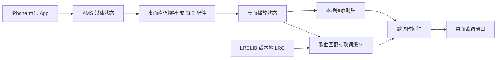

# iPhone 音乐歌词同步到桌面：技术方案调研

调研日期：2026-10-13。已完成文档调研、Windows 蓝牙能力检查、iPhone / YouTube Music 的真实 AMS 状态读取，以及原生桌面歌词首版。运行与验证见 [桌面 MVP](desktop-mvp.md)。

## 1. 建议与前提

已确认产品边界：**桌面端独立获取、匹配和渲染歌词，并由桌面控制歌词的位置、字体、样式、置顶和时间偏移；手机负责播放与音频输出，桌面通过 AMS 获取歌曲状态并可转发基本播放命令。** 数据采集不依赖手机显示歌词页，也不依赖截图、OCR、屏幕镜像或 UI 自动化。

iPhone / 连接手机的耳机继续播放。当前实测组合为 Windows 宿主 + iPhone + YouTube Music，开发入口运行于 WSL。其他播放器和桌面平台另行验证。

**跨播放器方向优先研究 Apple Media Service（AMS）：获取歌曲元数据与播放进度，再由桌面匹配时间轴歌词。** 它传递媒体状态，不传递音乐 App 的歌词页面。协议定义当前播放器与曲目信息，但不能保证每个 App 都完整提供数据。[Apple AMS 规范](https://developer.apple.com/library/archive/documentation/CoreBluetooth/Reference/AppleMediaService_Reference/Specification/Specification.html)

**当前优先采用原生 Windows AMS 接入。** 用户建立手机蓝牙关系后，定向服务发现、共享打开、属性读取，以及暂停、恢复、进度跳转和切歌通知均已成功验证。300 秒采集获得 42 条真实事件。结果与剩余验收项见 [YouTube Music 实测](youtubemusic-ams-validation.md)。

工程上分为两个明确候选：

- **纯软件桌面直连**：此次 Windows 已有设备关系上的 AMS 访问与控制事件已验证；后续重点是稳定曲目快照、锁屏与重连。Windows 服务请求广播限制不阻塞这条已实测访问路径。
- **BLE 配件 + USB 桥接**：让小型开发板连接 iPhone，把媒体事件通过 USB 串口转发给桌面。Nordic 已有 AMS 配件读取数据并输出 UART 的官方样例；此路线的参考实现证据更强，代价是多一个配件。[Nordic AMS 样例](https://nrfconnectdocs.nordicsemi.com/ncs/latest/nrf/samples/bluetooth/peripheral_ams_client/README.html)

若明确只支持 Spotify，可另行选择云端播放状态 API。桌面歌词内容与逐字时间轴由桌面选择的歌词源提供。

2026-10-13 选型修订：**排除 iPhone-use 的 USB / WDA 界面采集路线。** 已检查实现提供界面与画面读取，不满足本项目要求的数据源边界。USB 可作为传输候选，但必须另有可靠的歌曲 / 进度生产者；复用端口转发本身不能补足媒体状态接口。已评估路线的证据保留在 [USB / WDA 分析](usb-wda-feasibility.md)。

## 2. 候选路线比较

| 路线 | 声音留在手机 | 适用范围 | 当前判断 |
| --- | --- | --- | --- |
| AMS 桌面直连 | 当前状态链路不转移音频 | 已实测 YouTube Music，其他 App 另测 | 歌曲、进度及控制事件通过；锁屏、重连、音频对齐待测 |
| AMS 配件 → USB → 桌面 | 设计目标是保留 | 同上 | 厂商有配件样例，完整歌词链路待实现 |
| Spotify Web API | 无需转移播放设备 | Spotify 账户当前播放 | 官方状态接口可用，需授权和配额评估 |
| Apple Music 手机伴随 App → 局域网 | 可以 | Apple Music 系统播放器 | 公共 API 有播放器入口；长期后台同步另有难点 |
| 普通 iOS App 监听任意其他 App | 不涉及转移 | 期待全局监听 | 本次未找到支持该能力的通用公共 API |

各 iOS API 和 AirPlay 的具体证据见 [iOS 播放信息调研](ios-playback-research.md)。Spotify 状态与设备字段由 [Get Playback State](https://developer.spotify.com/documentation/web-api/reference/get-information-about-the-users-current-playback) 定义。

AirPlay / 屏幕镜像与 USB / WDA 界面采集不作为本项目候选。保留的路线只向桌面提供结构化播放状态。

## 3. AMS 接入的关键门槛

### 连接角色不能混淆

成熟示例的流程是：配件广播，iPhone 主动连接；配件在这条连接上作为 GATT client 读取手机上的 AMS。**GAP peripheral 与 GATT client 可以同时成立。** NXP 文档还明确使用服务请求广播和 BLE 安全连接。[NXP ANCS/AMS 示例](https://docs.mcuxpresso.nxp.com/mcuxsdk/latest/middleware/wireless/bluetooth/doc/Bluetooth%20Low%20Energy%20Demo%20Applications%20Users%20Guide/topics/ancs_client.html)

因此不能把「Bleak 扫描 iPhone，再读取 UUID」直接视为现成方案。Bleak 官方定位是连接广播中的 BLE peripheral 的 GATT client；这与上述配件建立连接的方式并不等价。[Bleak 文档](https://bleak.readthedocs.io/en/stable/)

已通过原生 Windows WinRT 实测宿主适配器支持 BLE、central 和 peripheral，蓝牙已开启。最初设备列表为空；用户连接手机后，已枚举目标并成功读取 AMS。最新媒体结果见 [YouTube Music 实测](youtubemusic-ams-validation.md)，早期硬件检查见 [第一阶段探针记录](playback-source-probe.md)。

Microsoft 的 `BluetoothLEAdvertisementPublisher` 禁止 `0x15` 服务请求广播，因此不能原样复现配件连接流程；这项限制仍成立。此次使用 GATT client 定向访问已存在的手机端点，显式以 `SharedReadAndWrite` 打开 AMS 服务后读取成功，无需发送该广播。[广播限制](https://learn.microsoft.com/en-us/uwp/api/windows.devices.bluetooth.advertisement.bluetoothleadvertisementpublisher?view=winrt-26100)、[GATT client](https://learn.microsoft.com/en-us/windows/apps/develop/devices-sensors/gatt-client)

不要在电脑上冒充发布 AMS server；需要读取的是 iPhone 的服务。macOS / Linux 也需要各自验证连接角色与权限，不能从 Windows 的结论外推。

### 配件路线如何落地

优先复用已有样例所支持的板卡和协议库，再增加 USB 串口输出；不需要配件上的屏幕。Adafruit 的 ESP32-S3 示例展示服务请求广播、连接配对与 AMS 读取，可作为另一参考实现；不能据此声称所有 ESP32 型号均可直接运行。[Adafruit ESP32-S3 示例](https://learn.adafruit.com/esp32-s3-ble-ios-media-controller/code-the-media-controller)

配件侧负责连接、订阅、属性完整读取和原始事件转发。桌面侧负责歌曲匹配、歌词文件、时间轴及窗口。早期只读探针曾不发送播放控制命令以减少实测变量；当前 Windows 桌面程序已接入 AMS Remote Command 的播放、暂停和切歌操作。

协议未要求 AMS 必须成为音频输出设备；但「AirPods 同时使用、锁屏、跨 App 切换仍稳定工作」是实机验收项，不能仅凭协议宣布支持。

## 4. 歌词获取与匹配

**MVP 使用 LRCLIB + 本地 LRC 导入。** LRCLIB 的公开 API 无需 API key，按歌名、艺人、专辑及歌曲时长查询，返回纯文本与带时间戳歌词。时长匹配允许约 ±2 秒差异；接口自述为实验性。本次没有测量中文曲库覆盖率。[LRCLIB API](https://lrclib.net/docs)

实际样本《羁绊》 / 许嵩的精确查询未命中，候选搜索亦为空。因此本地 LRC 是这首歌的明确输入选项；若要求自动覆盖它，需要另选歌词源。不能由单首查询推导整体中文覆盖率。

《夜的第七章》 / Jay Chou 已找到带时间戳候选，但存在多个版本，尚未自动选定。YouTube Music 的视频条目可能将频道名作为艺人，不能把它直接当成真实歌手；对应条目的歌词映射需要单独确认。

建议处理流程（以下为项目设计选择）：

1. 使用标题、艺人、专辑和时长查询，保留 Live、Remix、伴奏等版本标记。
2. 精确匹配未命中时提供候选选择；不要自动选搜索结果第一条。
3. 歌曲映射、歌词和用户偏移分别缓存；同名不同版本不能共享错误映射。
4. 没有时间戳时显示静态歌词；无歌词、纯音乐、网络错误采用不同状态。
5. 用户可导入本地 LRC。切歌后丢弃上一首歌尚未完成的请求结果。

Apple Music 的 `hasLyrics` 仅说明目录中存在歌词。检查的公开歌曲模型没有歌词正文和逐行时间轴字段，不能把该布尔值当成歌词获取 API。[MusicKit hasLyrics](https://developer.apple.com/documentation/musickit/song/haslyrics)、[Apple Music 歌曲属性](https://developer.apple.com/documentation/applemusicapi/songs/attributes-data.dictionary)

若未来需要授权歌词服务，可评估 Musixmatch；其官方 SDK 包含 Subtitle API。具体访问权限、显示范围与缓存条件需按实际服务方案确认，目前未验证账号。[Musixmatch 官方 SDK](https://github.com/musixmatch/musixmatch-sdk)

## 5. 桌面同步架构



Windows / YouTube Music 的状态直连与 C# / WPF 桌面歌词链路已实现并实测；当前使用 AMS 直连和 LRCLIB / 本地 LRC，不包含配件桥接实现。

接入层将 AMS、播放器官方 API 或专用伴随 App 的数据统一转换为播放快照。桌面显示层只消费快照和本地歌词，不访问手机界面。歌名与位置是最低输入；准确处理暂停、恢复和版本匹配还需要播放状态、速率，以及可获得的艺人、专辑、时长。曲目身份和进度必须对应同一首歌，位置锚点需绑定接收时的桌面单调时钟。

播放状态至少包含：播放器名、曲目标识、标题、艺人、专辑、时长、播放状态、速率、位置锚点、桌面单调时钟锚点、连接状态和本地曲目代次。AMS 没有统一目录歌曲 ID，项目需要根据可获得的元数据与队列信息建立身份；快速切歌时属性可能分批到达，不能假定一条通知就是完整歌曲快照。

### 用锚点推进时间轴

```text
播放中：position = anchorPosition + (monotonicNow - anchorTime) × playbackRate
暂停时：position = anchorPosition
歌词时间：lyricTime = position + userOffset
```

AMS 的 elapsed time 不是连续逐秒计数，官方定义了按播放速率与本地时间外推的方式。[AMS 属性参考](https://developer.apple.com/library/archive/documentation/CoreBluetooth/Reference/AppleMediaService_Reference/Appendix/Appendix.html)

实现选择：收到暂停、恢复、拖动、切歌事件就更新锚点；逐行定位使用已解析的时间戳。MVP 支持逐行高亮，逐字效果要求歌词源提供对应时间戳。用户偏移约定为正值让歌词提前。

以下问题必须显式处理：

- BLE 通知和 USB 转发存在延迟；桌面接收时间并不等于手机事件发生时间。先记录测量结果，再决定是否补偿。
- 切歌时清除旧歌词和旧锚点，等新曲目身份和位置可用后恢复；本地代次阻止旧异步结果覆盖新曲目。
- 收到连接断开或服务失效时停止外推并显示同步中断。长时间没有属性变化本身不能判定断线，因为正常播放不保证持续发送通知。
- 重连后重新取得状态与订阅，处理 AMS 服务发布变化；不要沿用断线前的位置。
- 长属性发生截断时需要读取完整值，否则中文长标题可能影响匹配。

前两项是项目一致性设计；服务变化与属性截断由 [AMS 规范](https://developer.apple.com/library/archive/documentation/CoreBluetooth/Reference/AppleMediaService_Reference/Specification/Specification.html) 明确描述。

实测已出现新标题先到、旧位置仍暂存的切歌过渡，因此曲目代次和位置失效处理是已确认的必要行为；初始完整属性读取亦为多次 GATT 操作，不能假定原子快照。

### 技术栈选择

连接验证只做日志探针，不先搭整套界面。若目标为 Windows，可先用 C# / WinRT 探针，成功后采用 C# + WPF 歌词窗口；配件路线也可先用 Python 读取串口日志。若已确定跨平台需求，再选择桌面外壳并实现各平台的接入层。

本地播放时钟、LRC 解析及行定位保持纯内存计算；HTTP 查询、缓存读写和蓝牙 / 串口 I/O 由对应边界承担。窗口目标包括置顶、拖动、字体大小、透明度及可切换鼠标穿透。

## 6. Spotify 专用分支

桌面授权后查询 `GET /v1/me/player`，scope 为 `user-read-playback-state`，可取得歌曲、播放进度、是否播放及活动设备。这个接口观察账户播放状态，所以要确认当前活动设备确实是目标手机；`progress_ms`、曲目等可为空，未获得位置时不能推算同步。[Spotify Playback State](https://developer.spotify.com/documentation/web-api/reference/get-information-about-the-users-current-playback)

桌面应用采用 Authorization Code with PKCE，避免内置客户端密钥。[Spotify PKCE](https://developer.spotify.com/documentation/web-api/tutorials/code-pkce-flow)

可以从 2–5 秒轮询加本地时钟开始测量，但这只是初始试验参数，并非配额或实时性保证；暂停、拖动和切歌发现可能延迟至下一次成功查询。限流时尊重 `Retry-After`。开发模式还有独立配额桶，耗尽后不应持续重试。[速率限制](https://developer.spotify.com/documentation/web-api/concepts/rate-limits)、[配额模式](https://developer.spotify.com/documentation/web-api/concepts/quota-modes)

截至本次查询，开发模式要求应用拥有者保持 Premium，通常最多 5 个授权用户。2026 年 7 月更新把 Client ID 上限改为 25，并按开发者账户共享配额，不能沿用 2 月公告里的单应用上限信息。[当前配额模式](https://developer.spotify.com/documentation/web-api/concepts/quota-modes)、[2026-07 更新](https://developer.spotify.com/blog/2026-07-23-web-api-quota-updates)

发布决策还有一个具体未决点：Spotify Developer Policy 包含声音与视觉媒体同步限制，公开文本没有给本方案逐行歌词展示的明确例外。本报告只确认状态 API 的技术能力，未确认独立歌词产品的发布许可。[Spotify Developer Policy](https://developer.spotify.com/policy)

## 7. 下一步验证与决策门槛

以下为建议验收目标，均不是已有实测结果。

| 阶段 | 实验 | 通过标准 / 决策 |
| --- | --- | --- |
| 需求确定 | 已确认桌面独立歌词、手机负责播放并提供状态，桌面可转发基本播放控制；继续确认音乐 App、桌面系统与配件接受度 | 选定结构化播放状态路线 |
| 连接探针 | 配对、发现 AMS、订阅歌曲与进度；记录广播 / 安全 / 服务问题 | 能得到真实手机播放事件；直连失败则记录具体阻塞，不先做 UI |
| 播放场景 | 播放、暂停、恢复、前后拖动、连续切歌、单曲循环 | 每项有锚点和曲目一致性记录 |
| 手机场景 | 锁屏、切 App、AirPods 并用、出范围后回来、桌面休眠恢复 | 验证支持范围与重连，不把单次成功当长期稳定 |
| 数据源独立性 | 手机不打开歌词页，桌面自主切换字体、布局与时间偏移 | 状态同步和歌词展示均不依赖手机视图 |
| 歌词匹配 | 常听歌曲样本，含中文、英文、Live / Remix | 分别统计有歌词、带时间戳、版本正确率，记录分母 |
| 同步测量 | 以实际听到的音频为参考，而不只比手机进度条 | 初始目标：稳定播放误差 ≤500ms；控制事件后 ≤1s 收敛；实测后调整 |
| 最小界面 | 缓存歌词 + 播放锚点 → 单窗口逐行高亮 | 切歌不残留旧歌词；断连不继续错误滚动 |

**建议先完成「手机 → 歌名 / 播放进度日志」这一条链路。** 若目标 App 不提供可靠的进度与拖动更新，就不能承诺全自动歌词同步；需要重新选择播放源或明确接受手动校准。

当前已完成调研、宿主蓝牙能力检查、YouTube Music 的 AMS 读取与控制事件验证，以及桌面状态适配、歌词匹配、缓存和原生悬浮窗口首版。《夜的第七章》的真实状态与 43 行歌词已在窗口显示；实际音频对齐和长期连接场景仍待验收。最新交付与复现命令见 [桌面 MVP](desktop-mvp.md) 和 [YouTube Music 实测](youtubemusic-ams-validation.md)。未运行前端构建，遵守 WSL 构建禁令。
